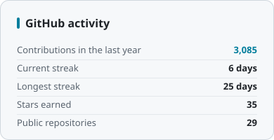
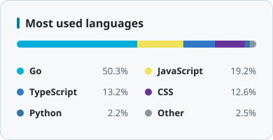

  <picture>
    <source media="(prefers-color-scheme: dark)" srcset="https://raw.githubusercontent.com/SobirovAzizbekFarhodovich/SobirovAzizbekFarhodovich/main/assets/header-dark.svg">
    
  </picture>

  
  
  
  
  

### About me

I build scalable, efficient backend services in Go, from RESTful APIs to microservice systems that talk over gRPC and Kafka.

- **Building:** REST and gRPC APIs, microservices, event-driven messaging with Kafka
- **Data:** PostgreSQL, MySQL, MongoDB, Redis
- **Shipping:** Docker, AWS, CI with GitHub Actions, APIs documented with Swagger
- **Learning:** distributed systems
- **Open to:** new opportunities and open-source collaboration

### Tech stack

  <picture>
    <source media="(prefers-color-scheme: dark)" srcset="https://raw.githubusercontent.com/SobirovAzizbekFarhodovich/SobirovAzizbekFarhodovich/main/assets/stack-1-dark.svg">
    
  </picture>
  <picture>
    <source media="(prefers-color-scheme: dark)" srcset="https://raw.githubusercontent.com/SobirovAzizbekFarhodovich/SobirovAzizbekFarhodovich/main/assets/stack-2-dark.svg">
    
  </picture>

### Featured projects

- **[PersonalFinanceTracker](https://github.com/SobirovAzizbekFarhodovich/PersonalFinanceTracker)**: budgets, goals and transactions as Go microservices. An API gateway, an auth service on PostgreSQL, Redis and Kafka, and a budgeting service on MongoDB, connected over gRPC.
- **[FoodDelivery](https://github.com/SobirovAzizbekFarhodovich/FoodDelivery)**: food ordering backend with products, carts and orders, split into Go microservices with gRPC, PostgreSQL, Redis and Kafka.
- **[OnlineVotingSystem](https://github.com/SobirovAzizbekFarhodovich/OnlineVotingSystem)**: elections, candidates, parties and votes. gRPC services on PostgreSQL behind a Gin API gateway with Swagger docs.
- **[LibcoinAuthService](https://github.com/SobirovAzizbekFarhodovich/LibcoinAuthService)**: authentication for a reading platform where PDP students book books, meet deadlines and earn LibCoins. Go, gRPC, PostgreSQL, Redis, Kafka.

### GitHub stats

  <picture>
    <source media="(prefers-color-scheme: dark)" srcset="https://raw.githubusercontent.com/SobirovAzizbekFarhodovich/SobirovAzizbekFarhodovich/output/stats-dark.svg">
    
  </picture>
  <picture>
    <source media="(prefers-color-scheme: dark)" srcset="https://raw.githubusercontent.com/SobirovAzizbekFarhodovich/SobirovAzizbekFarhodovich/output/languages-dark.svg">
    
  </picture>

<picture>
  <source media="(prefers-color-scheme: dark)" srcset="https://raw.githubusercontent.com/SobirovAzizbekFarhodovich/SobirovAzizbekFarhodovich/output/github-snake-dark.svg">
  
</picture>
